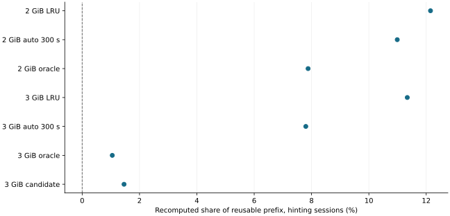

# Tool-type wait advice cut CPU-offload recompute to 1.5% from 7.8% for the best server-only hold, but only inside a pool-size window

2026-11-16 · current · mixed

On vLLM's CPU KV offload with a 40% long-wait agent mix, a GPU-aware hold policy driven by tool-type wait advice (expected return, done, ephemeral, keep_tokens) recomputed 1.5% of hinting sessions' reusable prefix at a 3 GiB pool, against 7.8% for the best server-only hold (300 s, keep oldest) and 11.3% for LRU; it was lower than the best server-only arm in 5 of 5 seeds (mean lead 6.3 points) and reached 94% of the exact-information arm's improvement over that comparator ((7.81 - 1.46) / (7.81 - 1.06)). Non-hinting sessions also fell from 8.5-26.1% to 0-4.6% through release advice. The benefit depends on pool size: at 2 GiB the oracle's mean lead was 3.1 points (4 of 5 seeds), at 4 GiB LRU recomputed nothing, and with the 15% long-wait mix the opportunity was 2.7-8.5% and both pre-registered 3-seed gates failed. Short waits usually hit the GPU prefix cache (all of them at 3 GiB; one 2 GiB LRU cell recomputed 2.3% of tool-type tokens), and holding them first was the flaw that sank the original ranking. The advice bundles timing and release, with no ablation separating them, and the campaign was adaptive: the design, comparator and decision rule changed after two failed gates.

40% long-wait mix, mean of 5 paired seeds per bar, single observations per seed, no intervals. Lower is better. Auto 300 s keeps the oldest holds; the oracle uses exact return times.

## Scope

Native Ubuntu, one RTX 2080 Ti, Qwen2.5-7B-Instruct-AWQ fp16 KV (55,296 GPU KV tokens), vLLM 0.34.0rc1.dev465+ge9281bd93 with the post-response patch for every arm, 6 running requests, 9 sessions of 7-10 turns with a shared 2,048-token system prompt, abandoning and non-hinting sessions and one-off requests. Stage A calibration (7 cells), phase 1 (15% long mix, 17 cells), phase 1b (40% long mix, 10 cells) and the cache-size sweep (26 cells); every rule was fixed in Git before its data (d8a0f1b0, 07a8ed29 amended d72f9347, f0f608ed). All counted cells completed with no failures; one phase 1 uncapped-oracle cell is flagged for concurrent analysis load on the host.

## Limits

One model, one consumer GPU, 9 sessions, LRU base only; ARC and a tight pool were not run. The 40% long-wait share is authored (captured traces have about 1% of waits over 30 s). Five single observations per cell, no intervals; per-seed leads at 3 GiB ranged 3.5-11.6 points. The GPU-aware rule and the 300 s keep-oldest comparator were added after the first gate failed; the sweep's 4-of-5 rule replaced the all-seeds rule before sweep data. The GPU retention (60 s) was measured offline and fixed. The sizing rule (hold budget covering sessions in long waits) rests on three pool sizes. TTFT and recompute only, no end-to-end task time.

## Decision

Retain the GPU-aware advised hold (AdvisedGpu*), the keep-oldest server-only comparator and the agent-mix workload as the evidence for an upstream RFC that targets the CPU-offload policy layer and asks which interface (#52113, #51428, #57103) should carry the advice. The first ranking (AdvisedHold*) stays only as recorded evidence of the flaw. Open: ARC, more sessions and GPUs, captured traces, online GPU-retention estimation.

## Correction

2026-11-16 review by GPT-6 Astra: 93% corrected to 94% (unrounded seed means), and the claim that short waits never recomputed corrected (one 2 GiB LRU cell recomputed 2.3% of tool-type tokens); attribution and adaptive-campaign caveats added. Source: evidence.json.

## Sources

- [results/agent-wait-advice/evidence.json](../sources/9c1755edf3792c6032a5e07fad48615d07d751edf769787b88729b3503d94f0e.json)

Exact source hashes and figure inputs: [result.json](result.json).
