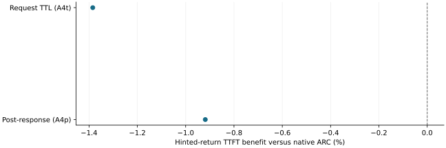

# 2080 Ti screen finds no ARC-route speedup; both routes remain inconclusive

2026-11-14 · current · unresolved

Both bounded hold-only routes are feasible on frozen vLLM, but this screen does not justify promotion. On D8/W1, request-TTL hints (A4t) slowed hinted-return first-token latency by 1.38%; post-response hints (A4p) slowed it by 0.92%. Both formal verdicts are INCONCLUSIVE: required bootstrap intervals are unavailable, and harm bounds are not established.

D8/W1, three paired decision seeds. Positive means faster. Points only: required 95% BCa intervals are unavailable because bootstrap draws omit a required stratum; omitted error bars do not imply precision. The frozen worthwhile-benefit target is 15%.

## Scope

The frozen upstream revision is e9281bd939d4ade90d6aacf4b2319aa89ea46c39, using its exact wheel plus hashed compatibility patches. D8 is Qwen3-8B-AWQ; HM is Qwen3.5-4B-AWQ; HS is Gemma-4-12B-AWQ.

| Model / workload | A4t | A4p | Coverage / opportunity |
| --- | --- | --- | --- |
| D8 / W1 | INCONCLUSIVE | INCONCLUSIVE | Three complete paired seeds; opportunity present (20.38% baseline recomputation) |
| HM / W1 | INCONCLUSIVE | INCONCLUSIVE | Admitted; three baseline sizing cells only; opportunity unmeasured |
| HS / all workloads | Not admitted | Not admitted | Insufficient GPU KV capacity at frozen settings |
| D8, HM / W2 and W2-12s | INCONCLUSIVE: not run | INCONCLUSIVE: not run | Budget did not permit a complete block; opportunity unmeasured |

D8 has 21 valid cells and 1,603 planned requests, all complete. Whole-route post-response minus TTL benefit is +0.466 percentage points (delta sensitivity [-0.737, +1.669] pp; BCa unavailable). This does not isolate the delivery hook. Both treatments increased hinted recomputation by 1.286 pp. First-task sensitivity remains unfavorable. All-arm comparisons, disabled controls, raw denominators and diagnostics are retained in [detailed evidence](evidence-notes.md).

| Harm versus A2 | A4t | A4p |
| --- | ---: | ---: |
| Unhinted first-token latency | -12.67% | -13.69% |
| Unhinted inter-token latency | +10.36% | +10.91% |
| One-shot first-token latency | -12.26% | -11.10% |
| One-shot inter-token latency | -1.41% | -1.31% |
| Unhinted recomputation | -5.48 pp | -5.48 pp |

Positive means harm. Point estimates alone do not establish safety; [all intervals and margins](guardrails.json) are retained. No failed stores/transfers or request errors occurred. Native allocation refusals were TTL 10/4/15 and post 8/4/15 versus A2 9/4/16. Replay found no direct hold obstruction, without ruling out indirect effects.

GPU use: **8.28537 hours**, comprising 0.52917 admission and 7.75619 screen. Invalid decision attempts consumed 1.32401 hours and remain charged and retained. D8 seeds 12104–12108, HM working-set/all-arm calibration and all decision seeds, remaining HS admission arms, and both W2 variants are not run. Stage 2b, Stage 3 (including the 2080 Ti pilot), 5080/rental, simulator and competitor lanes are not run.

## Limits

With only three seeds, some bootstrap draws omit a required prompt stratum. The frozen BCa rule therefore refuses an interval; the delta sensitivity alone would STOP and cannot replace it. A/A intervals excluding zero triggered fresh CPU rechecks, which passed native disabled-policy and A3p/A3 identity. Actual serving-control shifts remain; their overhead/scheduling causes are not isolated.

Holds were active (91 TTL, 39 post-response leases), but each route restored only 576 hinted-return tokens from CPU out of 191,296 raw eligible tokens; most reuse was on GPU. Opportunity-labelled recomputation is not proof of recoverable CPU-prefix opportunity. The calibrated pool was 1.316 times finite-horizon mean demand, with burst pressure and low mean overlap. W1 is mostly truncated recorded-prompt replay with synthetic gaps, not live task success.

D8 admission byte checks did not exercise active holds; HM did. GPU capture overhead has no uninstrumented control; clocks and Windows activity were not captured. Startup swap stops, a CUDA mapped-pointer failure, a resource-capture race and outside CPU interference required retained repairs/reruns. The implementation uses pinned private scheduler state, has material adversarial bookkeeping cost, and is not wholly unpatched upstream. All raw attempts remain retained.

## Decision

Hold 5080 promotion. Larger hardware could fill model/pressure coverage gaps, but would buy additional evidence without a positive ARC benefit signal here. Any follow-up needs separately authorized prospective scope and budget; preserve this screen's verdict. Philip must still decide the proposed fixed 5% later-stage harm limit and whether to authorize Stage 2b public outreach. No public message or later-stage GPU work was performed.

Swappiness is restored to 60 and the acquisition healthcheck is deleted. Full acceptance passed 143 CPU tests and 105 rule proofs. [Regeneration](regeneration.json) uses maintained entry points and retained numeric inputs; four representative statistics and both verdicts reproduce exactly. Keep the implementation, instruments and evidence; no raw attempts or shared dependencies were pruned.

## Sources

- [results/pr-evidence-2080ti/evidence.json](../sources/bd4fead6fd28179baea42d91e83b2bd557f875ba791bd98dff579dfef8c7db28.json)
- [results/pr-evidence-2080ti/evidence-notes.md](../sources/f40b851aec2dc36ead4beaf7dab6d356f6553b8facb737b9e9ec1d5a55eb73fc.json)
- [results/pr-evidence-2080ti/analysis-index.json](../sources/20351ffc86e57026bd7f03117d5524198543e99e6be0155afed86c3e79889e6e.json)
- [results/pr-evidence-2080ti/statistics-primary.json](../sources/d9cc6ee777760522d977929485f6499f37ae40e498a81dbf4364d71579342c7e.json)
- [results/pr-evidence-2080ti/statistics-first-task-occurrence.json](../sources/c4ae42aa36095b2819340cf4bca73fb81af0f94c8dc7efa8d071298217938a67.json)
- [results/pr-evidence-2080ti/guardrails.json](../sources/d52dde5406fcb8f2135bf240bad5e819987009d53469ae56aa7a5b020a5fce2e.json)
- [results/pr-evidence-2080ti/aa-diagnosis.json](../sources/cb3fee63b561c3c9771ffbdf478b34c8012e9528a8b90552dcb43a3ea38bc07a.json)
- [results/pr-evidence-2080ti/verdicts.json](../sources/20a975ecabe250c7d480c12184cd0269b3450303c86a46368928fb937e783a3d.json)
- [results/pr-evidence-2080ti/regeneration.json](../sources/3178515cda0f6666990a0047aabf8b1b883beb34a68faca8432ef68556453e86.json)
- [results/pr-evidence-2080ti/cpu-attempts.json](../sources/d4c42c6023ac91de9f038d9900618dfbdbffa3b089df17d2d93024b9e2f64612.json)
- [benchmarks/pr-evidence/stage1-freeze.json](../sources/801c0c9cae0ce6ce92f1bdc59afb13e4a7b34ca118c0ef3936cc9f92c851a55b.json)
- [benchmarks/pr-evidence/2080ti-admission.json](../sources/f64f453ee33dc2683029ceb7238c1f3901729e76fb50438048e2f33c18ca278e.json)
- [benchmarks/pr-evidence/calibration/D8.json](../sources/a8456f5211eaccc94aa48bed4141f970e2aa92aa77e86af0e85c471aca3fc338.json)
- [benchmarks/pr-evidence/2080ti-screen-invalid-attempts.json](../sources/9ec93cb11e72d2d1ea7a6d284091812a78a9df7be3cb780d012c2bd77c47e423.json)
- [benchmarks/pr-evidence/2080ti-acquisition-close.json](../sources/671eba2ca480ba33bb42ac4f77d2f25454c45fea9088e04aff8f246199edd2c2.json)

Exact source hashes and figure inputs: [result.json](result.json).
